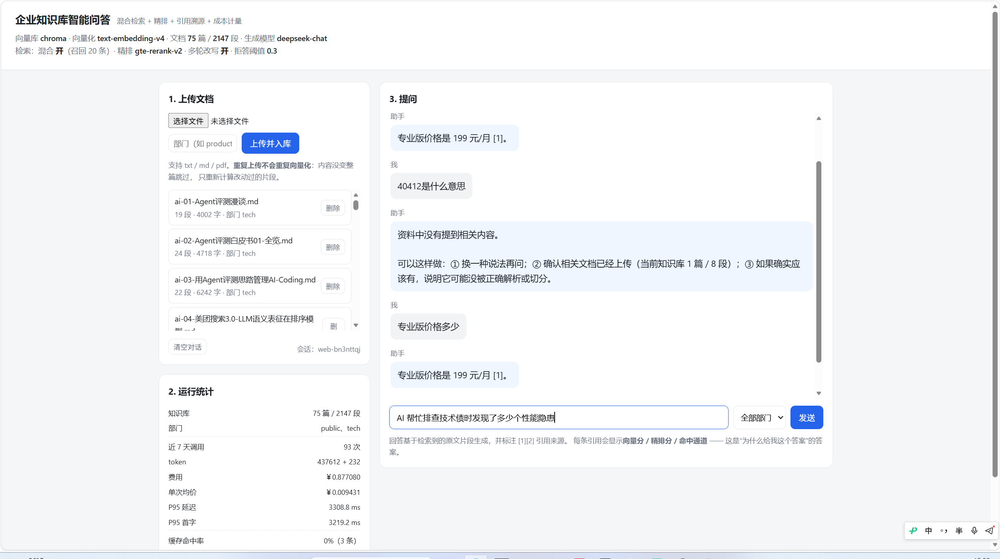
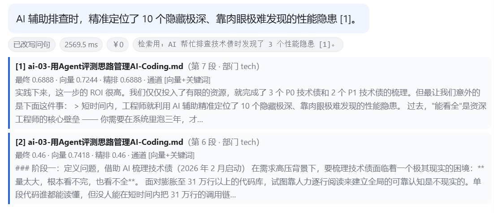
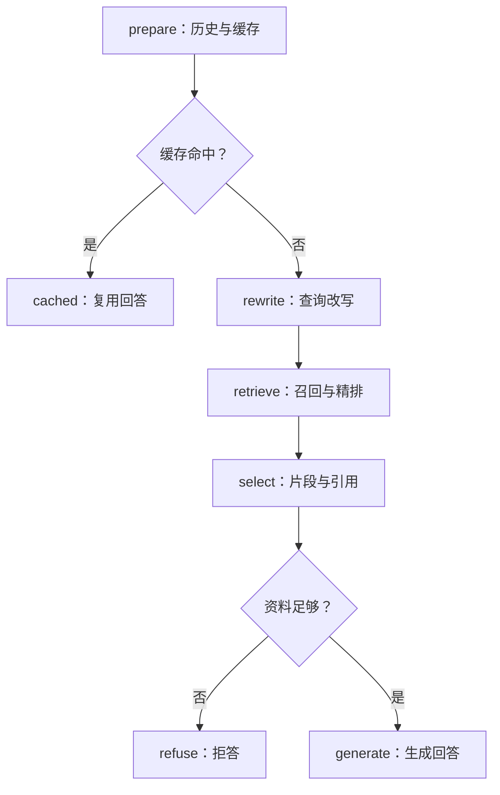
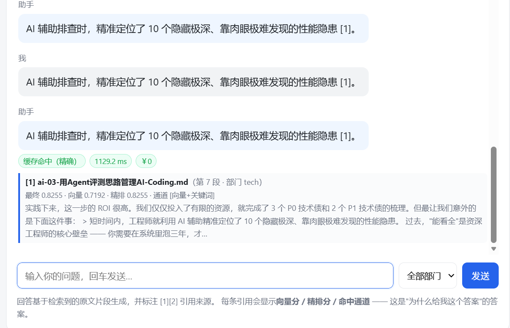
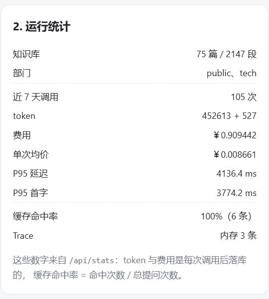

# 企业知识库智能问答（RAG）

**混合检索 · 两段式精排 · 引用溯源 · 拒答兜底 · 成本可计量**

一个把 RAG 从"能答"做到"可解释、可评测、可运维"的完整工程实现。
后端用 LangChain 接入模型与检索组件、用 LangGraph 把问答流程编排成一张真正执行的图；
前端是自带的零依赖控制台，回答里每一条引用都标注**向量分 / 精排分 / 命中通道** ——
这是"为什么给我这个答案"的答案。






---

## 目录

- [能力清单](#能力清单)
- [快速开始](#快速开始)
- [配置真实模型](#配置真实模型)
- [问答流程（LangGraph 图）](#问答流程langgraph-图)
- [检索链路：为什么这么做](#检索链路为什么这么做)
- [API](#api)
- [目录结构](#目录结构)
- [测试与评测](#测试与评测)
- [Docker 部署](#docker-部署)
- [边界与取舍](#边界与取舍)

---

## 能力清单

| 模块       | 能力                                                                                                              |
| ---------- | ----------------------------------------------------------------------------------------------------------------- |
| **入库**   | TXT / Markdown / PDF / CSV / JSON；标题感知切分；文档与片段指纹，**重复上传不重复向量化**（未改片段直接复用向量） |
| **召回**   | 向量检索 + BM25 关键词检索双路，**RRF 融合**（只吃名次不吃分数，免调权重）                                        |
| **精排**   | Cross-Encoder 重排，不可用时自动降级为 LLM listwise 重排，再不可用则关闭 —— 三级降级不中断服务                    |
| **拒答**   | 相关性阈值兜底：资料不足时明确说"不知道"，而不是编一个答案；阈值由标定脚本按你的语料算出                          |
| **多轮**   | 查询改写（"那学生呢？" → "学生版多少钱？"），首轮自动跳过不浪费调用                                               |
| **缓存**   | 精确缓存 + 语义缓存双通道，命中率可在控制台看到                                                                   |
| **引用**   | 每条回答标注来源片段与 [1][2] 编号，并显示该片段如何被选中                                                        |
| **流式**   | SSE 流式返回，协议为 `meta / citations / delta / done / error`                                                    |
| **计量**   | token 与费用按次落库（服务端 usage + 本地估算双来源）；`/api/stats` 直接看                                        |
| **可观测** | 请求级 Trace（节点、耗时、算子），`/api/traces/bad-cases` 一键筛出拒答与报错请求                                  |
| **治理**   | 写操作 API Key 鉴权、CORS 白名单、部门 / 文档类型过滤                                                             |

---

## 快速开始

推荐 Python 3.12。**不配任何 Key 也能启动**：此时走本地哈希向量 + 摘录式回答，
能完整跑通"上传 → 检索 → 引用 → 拒答"的链路，只是不懂语义。

```bash
python -m venv .venv

# Windows
.venv\Scripts\python.exe -m pip install -r requirements-chroma.txt
copy .env.example .env

# macOS / Linux
# .venv/bin/pip install -r requirements-chroma.txt
# cp .env.example .env

python run.py            # http://127.0.0.1:8000
```

打开页面后：上传 `data/sample/产品手册示例.md`，提问「专业版价格是多少？」或「40412 是什么意思？」。

想换成自己的语料，把文档放到任意目录，然后批量入库（增量、可重复跑，重复的文档会自动跳过）：

```bash
python scripts/bulk_ingest.py "D:\你的\文档目录" --dry-run    # 先看会导入哪些
python scripts/bulk_ingest.py "D:\你的\文档目录" --dept tech  # 真入库
```

Windows 下也可以直接双击 `启动.cmd`。

装不上 Chroma 时的退路：安装 `requirements.txt` 并把 `.env` 里的 `VECTOR_BACKEND` 设为 `memory`，
向量存储改用内置的纯 Python 实现 —— 依然跑在 LangChain / LangGraph 上，只是换了个存储后端。
启动后看 `/api/health` 里的 `vector_backend` 确认真实用的是哪个。

---

## 配置真实模型

```dotenv
# 对话模型（任何 OpenAI 兼容网关都可以）
LLM_API_KEY=你的Key
LLM_BASE_URL=https://api.deepseek.com/v1
LLM_MODEL=deepseek-chat

# 向量模型：local 是零依赖的哈希词袋，只够跑通流程；正式演示请用 api
EMBEDDING_MODE=api
EMBEDDING_API_KEY=你的Key
EMBEDDING_BASE_URL=https://dashscope.aliyuncs.com/compatible-mode/v1
EMBEDDING_MODEL=text-embedding-v4

VECTOR_BACKEND=chroma
```

**对话模型和向量模型可以是两家**（比如对话用 DeepSeek、向量用通义），它们的 Key 与地址各自独立配置。
地址和模型名以你账号控制台实际看到的为准 —— 不要因为名字里有 OpenAI 就以为只能调 OpenAI 的模型。

两个容易踩的坑：

1. **换向量模型后必须清空向量库重新入库**。不同模型的向量空间不通用，混着用检索结果会莫名其妙。
2. **`MIN_RERANK_SCORE` / `MIN_VECTOR_SCORE` 不能照抄默认值**，要用自己的语料标定：

```bash
python scripts/calibrate_threshold.py
```

它会用一组"与语料无关"的探针问题，测出"不该答的问题能拿到的最高分"，
再对照"该答对的问题的最低分"，给出建议阈值。阈值决定拒答的松紧，拍脑袋设的阈值一定会在演示时翻车。

---

## 问答流程（LangGraph 图）

问答不是一串顺序函数，而是一张有分支的图 —— 缓存命中和重新生成走的是不同路径：



`RagService.answer()` 调用 `workflow.invoke()`，流式走 `stream(stream_mode="custom")`。
`/api/traces` 里能看到每次请求实际经过的 `graph_nodes`，可以直接核对"这次到底走了哪条分支"。

图里仍然是自己写的 Python 函数 —— 框架的作用是把职责拆成节点、决定分支怎么走，
不是让业务逻辑凭空消失。

---

## 检索链路：为什么这么做

**① 召回用两路，而不是一路加权重。** 向量擅长语义（"学生优惠"能召回"教育折扣"），
BM25 擅长精确匹配（型号"40412"、专有名词）。两路各召回 20 条，用 **RRF** 融合 ——
RRF 只看排名不看分数，所以**不需要为两路分数调权重**（向量分和 BM25 分本来也不是同一量纲）。

**② 召回和精排分开，池子要够大。** `RETRIEVE_K=20` 先粗召回，`TOP_K=4` 才是喂给模型的数量。
池子太小精排没有发挥空间；但如果直接把 20 条都塞进 prompt，成本和噪声都会失控。

**③ 精排三级降级，永远有得用。**

```
auto → cross-encoder（有真实相关性分数，拒答判定更准）
     → 不可用 → LLM listwise（让对话模型给候选排序）
     → 不可用 → 关闭精排，退回向量分 + 关键词规则
```

listwise 只给顺序不给分数，所以拒答阈值仍然按向量分判定 —— 这个差异在 `app/retrieval.py` 里有说明。

**④ 宁可不答，也别乱答。** 相关性不足时直接走 `refuse` 节点输出"资料里没有"。
配合 `/api/traces/bad-cases` 把拒答和报错的请求筛出来复盘 —— 拒答不是故障，是待优化的信号。

---

## API

| 方法   | 路径                                  | 说明                               |
| ------ | ------------------------------------- | ---------------------------------- |
| GET    | `/api/health`                         | 健康检查 + 当前生效的检索/模型配置 |
| GET    | `/api/stats`                          | 用量、费用、缓存命中率、知识库统计 |
| POST   | `/api/chat/stream`                    | 提问（SSE 流式）                   |
| GET    | `/api/documents`                      | 列出已入库文档                     |
| DELETE | `/api/documents/{source}`             | 删除指定文档及其向量               |
| GET    | `/api/sessions/{session_id}/messages` | 会话历史                           |
| GET    | `/api/traces`                         | 最近的请求链路（倒序）             |
| GET    | `/api/traces/bad-cases`               | 需要复盘的请求：拒答 / 报错        |
| DELETE | `/api/cache`                          | 清空答案缓存                       |

完整交互式文档：启动后访问 `/docs`。

同一问题第二次提问会命中**精确缓存**：跳过检索与生成直接返回，引用完全一致，成本记 ¥0。
缓存命中率是**进程内计数**（服务重启归零），可在 `/api/stats` 查看：





## 目录结构

```
rag-demo-langchain/
├── app/
│   ├── main.py            # FastAPI 应用 + 全部接口 + 静态控制台挂载
│   ├── config.py          # 全部配置项（从 .env 读取）
│   ├── llm.py             # ChatOpenAI / RunnableSequence + 离线降级
│   ├── embedding_local.py # 零依赖哈希向量（跑通流程用）
│   ├── loaders.py         # TextLoader / PyPDFLoader + 编码与格式校验
│   ├── chunking.py        # RecursiveCharacterTextSplitter + 标题感知
│   ├── vectorstore.py     # langchain_chroma.Chroma / memory 后端
│   ├── retrieval.py       # ★ BM25 + 向量 + RRF + 精排 + 阈值拒答
│   ├── framework.py       # ★ BaseRetriever / Document 适配层
│   ├── rag.py             # 服务编排入口
│   ├── workflow.py        # ★ LangGraph StateGraph 问答图
│   ├── cache.py           # 精确缓存 + 语义缓存
│   ├── chat_store.py      # 会话历史（SQLite）
│   ├── docstore.py        # 文档与片段指纹（增量入库）
│   ├── usage.py           # token / 费用计量
│   ├── trace.py           # 请求链路记录
│   └── schemas.py         # 请求/响应模型
├── static/index.html      # 自带的可视化控制台（零构建、零依赖）
├── scripts/               # 标定、评测、批量入库、冒烟测试
├── tests/                 # 92 个测试
├── data/sample/           # 示例语料与评测集
├── Dockerfile / docker-compose.yml
├── requirements.txt           # 最小依赖（memory 后端）
├── requirements-chroma.txt    # 含 Chroma
└── requirements-dev.txt       # 含 pytest
```

---

## 测试与评测

```bash
.venv\Scripts\python.exe -m pip install -r requirements-dev.txt
.venv\Scripts\python.exe -m pytest -q -o addopts=""
```

覆盖切分、BM25/RRF 融合、重排、缓存、检索、RAG 主流程与 API 契约。
**测试不会调用付费模型**（模型相关用例走 Mock HTTP）。

评测与标定脚本：

| 脚本                                                | 用途                           |
| --------------------------------------------------- | ------------------------------ |
| `scripts/calibrate_threshold.py`                    | 用你的语料标定拒答阈值         |
| `scripts/evaluate_retrieval.py`                     | 检索质量评测（Hit Rate / MRR） |
| `scripts/evaluate.py`、`scripts/evaluate_corpus.py` | 端到端问答评测                 |
| `scripts/bulk_ingest.py`                            | 批量入库                       |
| `scripts/show_workflow.py`                          | 打印问答图结构                 |
| `scripts/smoke_test.py`                             | 冒烟测试                       |

> 换切分器、换向量模型、换语料之后，**旧的评测数值不能直接沿用** —— 片段边界变了，
> 分数就没有可比性，必须用新配置重跑一遍。

---

## Docker 部署

```bash
copy .env.example .env      # 填好 Key
docker compose up --build -d
docker compose logs -f
```

镜像里是非 root 用户（UID 10001）、带健康检查；`docker-compose.yml` 映射 8000 端口并挂载
`./data:/app/data`，所以资料、索引和 SQLite 数据都留在宿主机，容器重建不丢。
访问地址不变：`http://127.0.0.1:8000`。停止：`docker compose down`。

Linux 宿主机上如果用的是 bind mount，记得先确保 `data/` 对 UID 10001 可写 ——
镜像内的 chown 改不动宿主机目录的权限。

# 边界与取舍

以下都是已知边界，写在项目说明里比藏着更好：

2. 缓存键没有加入会话历史。相同问题在不同上下文里可能命中同一个缓存答案，涉及指代（"那它呢"）的场景请关掉缓存。多轮上下文隔离是后续要做的改造。

3. 部门过滤不等于权限系统。`DEFAULT_DEPT` + 文档元数据过滤只是检索范围收窄，不是账号级文档授权；`API_KEY` 也只是最简单的写操作鉴权。

4. 阈值和引用能控制风险，但不能消除幻觉。它们降低 "答错还理直气壮" 的概率，不保证答案一定正确。

5. 扫描件 PDF 没有 OCR。PyPDFLoader 抽不出图片里的文字，需要 OCR 的话得自己接。

6. `local` 向量模式不是语义向量，它是零依赖的哈希词袋，只用来跑通流程和证明降级路径可用，不要拿它的检索效果当作项目效果。

7. SQLite 里的会话历史不等于 LangGraph 的检查点持久化。图状态里含临时 Python 对象，本项目没有把图状态落库做断点续跑。

8. 费用有 "服务端 usage" 和 "本地估算" 两个来源，供应商价格需要按实际账号修改。
